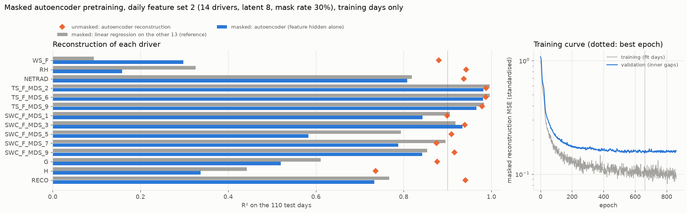
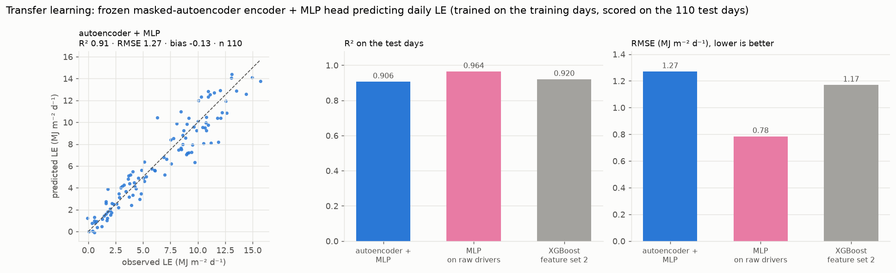
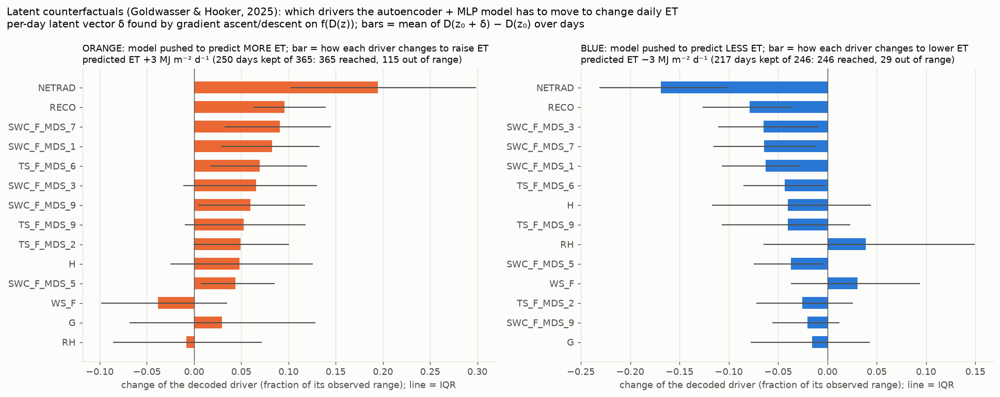
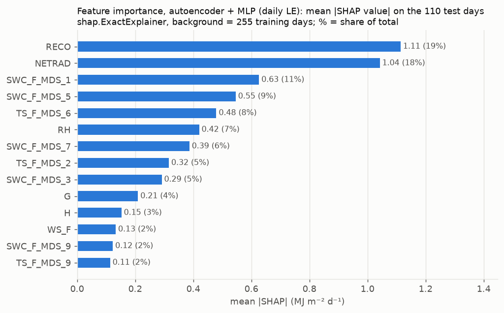
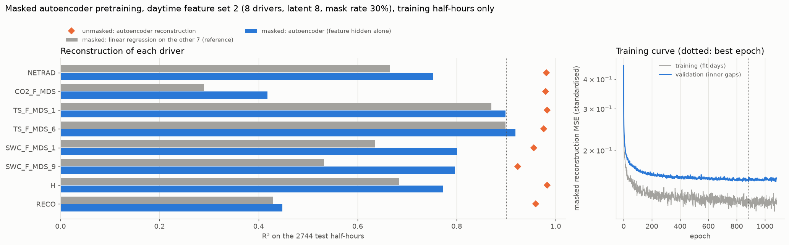
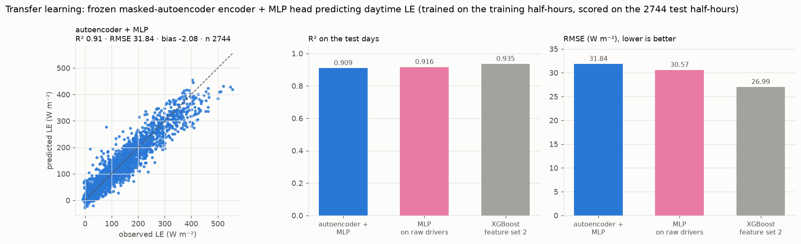
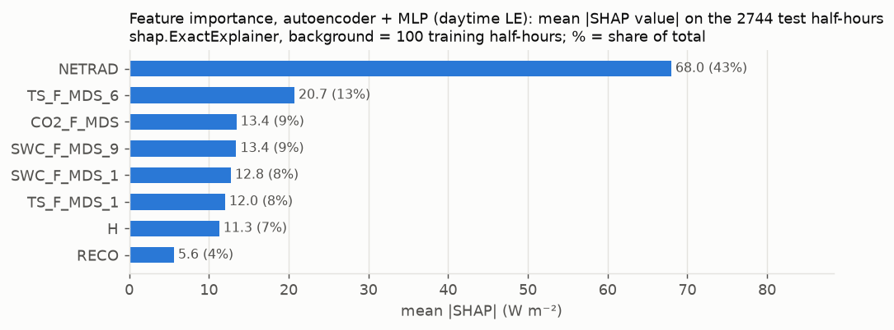

# Evapotranspiration drivers at US-ARM (2017): masked autoencoder + SHAP

[](https://colab.research.google.com/github/mich3leRusso/evotranspiration/blob/main/autoencoder.ipynb)

The notebook [`autoencoder.ipynb`](autoencoder.ipynb) predicts evapotranspiration (latent heat flux LE) at the
AmeriFlux site US-ARM (Lamont, Oklahoma) in 2017 with a masked autoencoder + MLP, and explains the model
with latent counterfactuals and SHAP values. All the functions are in [`autoencoder.py`](autoencoder.py).

## Before running: add the data file

The data file is **not** in this repository. You need the raw half-hourly FLUXNET file of US-ARM for 2017,
named exactly **`ARM_HH_2017.csv`**. It has one row per half-hour (17,520 rows), FLUXNET column names
(`TIMESTAMP_START`, `LE`, `NETRAD`, `SW_IN_F`, `TA_F`, `VPD_F`, `NIGHT`, …) and `-9999` for missing values.

The first cell of the notebook downloads this repository into a folder called `evotranspiration-main/`.
**Put `ARM_HH_2017.csv` in that folder**, next to `autoencoder.py`:

```
evotranspiration-main/
├── autoencoder.py
└── ARM_HH_2017.csv      <- here
```

**On Google Colab**
1. Click *Open in Colab* above.
2. Run only the first cell.
3. In the **Files** panel on the left, upload `ARM_HH_2017.csv` into `evotranspiration-main`.
4. Run the other cells (Runtime → Run after).

After a runtime restart Colab deletes the uploaded file, so upload it again.

**On your own computer:** run the first cell, copy `ARM_HH_2017.csv` into `evotranspiration-main/`, then run the rest.

If the file is missing, step 0 stops with `FileNotFoundError`. The first cell installs `torch`, `shap`, `xgboost`
and `scikit-learn` if they are missing. A full run takes about 3 minutes on a CPU.

## What the notebook does

0. **Preprocessing**: MDS gap-filling of the raw half-hourly data (Reichstein et al., 2005).
1. **Pretraining**: masked autoencoder on the drivers (training days only, LE is never seen).
2. **Transfer learning**: frozen encoder + MLP head that predicts LE.
3. **Latent counterfactuals** (daily only): which drivers the model has to change to raise or lower ET.
4. **SHAP values** (`shap.ExactExplainer`): contribution of each driver to the prediction.

It is run twice: on **daily** data (14 drivers) and on **daytime** half-hours (8 drivers).
Test data = 30 % artificial gaps (Moffat et al., 2007 gap lengths).

---

## Results: daily

### 1. Pretraining
Reconstruction of each driver on the 110 test days. Both criteria passed (mean unmasked R² = 0.915 ≥ 0.90;
every driver, hidden alone, reconstructed with R² > 0).



### 2. Transfer learning

| model | n_test | R² | RMSE | MAE | bias |
|---|---|---|---|---|---|
| autoencoder + MLP | 110 | 0.906 | 1.270 | 0.985 | −0.131 |
| MLP on raw drivers | 110 | 0.964 | 0.784 | 0.597 | 0.051 |
| XGBoost feature set 2 | 110 | 0.920 | 1.169 | 0.866 | −0.305 |



### 3. Latent counterfactuals
Orange: the model is pushed to predict more ET (+3 MJ m⁻² d⁻¹). Blue: pushed to predict less ET (−3 MJ m⁻² d⁻¹).
Bars = mean change of each decoded driver as a fraction of its observed range, ranked by bar length.



### 4. SHAP values



---

## Results: daytime

### 1. Pretraining
Mean unmasked R² = 0.968, both criteria passed.



### 2. Transfer learning

| model | n_test | R² | RMSE | MAE | bias |
|---|---|---|---|---|---|
| autoencoder + MLP | 2744 | 0.909 | 31.837 | 22.748 | −2.080 |
| MLP on raw drivers | 2744 | 0.916 | 30.572 | 21.977 | 0.658 |
| XGBoost feature set 2 | 2744 | 0.935 | 26.993 | 18.914 | 0.588 |



### 4. SHAP values
Background = 100 training half-hours (the library default).


